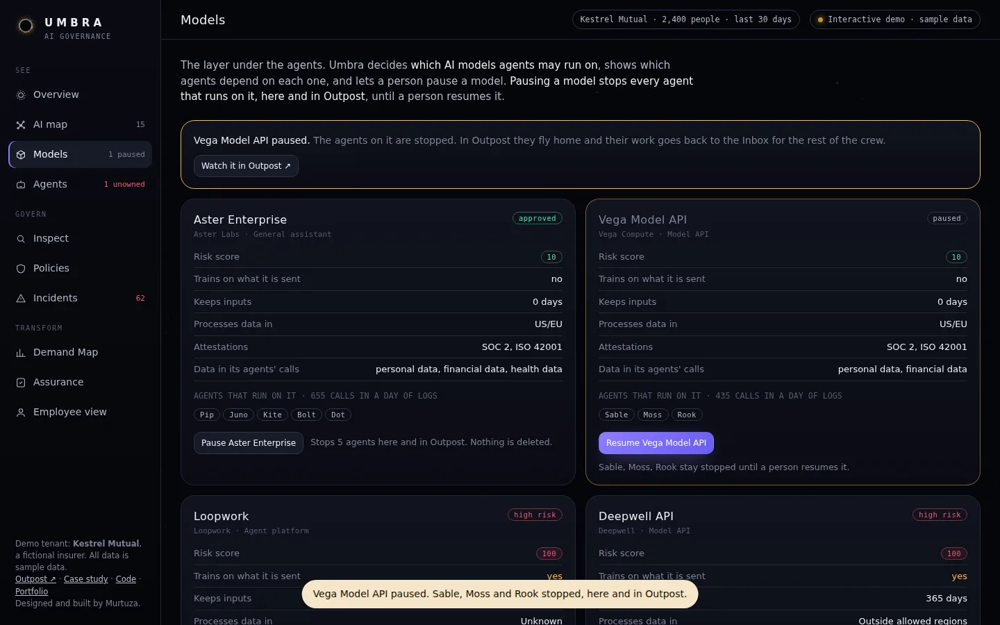

<p align="center"></p>

<h1 align="center">Umbra</h1>
<p align="center">Using AI to govern AI inside a company.</p>
<p align="center"><a href="https://murtuzabuilds.com/umbra/"><b>Interactive demo · sample data</b></a> · <a href="https://murtuzabuilds.com/umbra/case-study.html"><b>Case study</b></a> · <a href="https://murtuzabuilds.com/outpost/"><b>Outpost</b></a> · <a href="https://murtuzabuilds.com/"><b>Portfolio</b></a></p>


Umbra is a concept product I designed and built. It governs every AI tool and model a company uses: what is allowed, what data reaches it, and which agents get in. AI drafts rules; fixed rules and people decide. It also turns the unapproved tools it finds into a ranked list of where to invest in approved AI next.

## Why I built it

A lot of people now use AI at work that their employer never approved. In a January 2026 survey of 2,000 workers, 49% said they had, and 63% said it was fine when no approved option existed ([BlackFog, via CIO](https://www.cio.com/article/4124760/roughly-half-of-employees-are-using-unsanctioned-ai-tools-and-enterprise-leaders-are-major-culprits.html)). Blocking tools doesn't really fix that. People just use them somewhere IT can't see.

The early AI security startups were bought by large security vendors in 2024 and 2025, and their tools mostly focus on blocking. I wanted to try a different approach, closer to my background in digital transformation: protect the data, but also learn from what people are trying to do.

## Three ideas behind it

1. **Unapproved AI use shows what people need.** If a team keeps using an unapproved tool for a task, that is a sign they need an approved one. The Demand Map groups this by team and task and ranks where a tool would help most.
2. **AI can help write the rules, but not enforce them.** Umbra's AI layer, Corona (AI assistant), drafts rules from plain English, spots AI services that are not in the catalog and summarises incidents. The actual block or allow decision comes from fixed rules that give the same answer every time, and a person approves any new rule.
3. **Agents need owners and limits.** Each agent gets a named owner and a list of what it may do. Every call is checked against that list, and Umbra estimates how much data could be reached through an agent if it were compromised.

## What's in the console

| | |
|---|---|
| **Overview**: how much AI use is visible, the share on approved tools, how much sensitive data was contained, open cases, and Umbra at the centre | **AI map**: every AI service on one map, placed by risk and usage |
|  |  |
| **Inspect**: check any text, see what gets masked and which rules applied | **Agents**: who calls what, calls outside the limits, owners and exposure |
|  |  |
| **Policies**: write a rule in a sentence and "Test on last month" before turning it on | **Incidents**: 888 raw alerts grouped into 62 cases, each with a short summary |
|  |  |
| **Demand Map**: where approved AI would help most, as a now, next and later list | **Assurance**: controls mapped to the EU AI Act, ISO/IEC 42001, NIST AI RMF and SOC 2, with exports |
|  |  |
| **Models**: the models agents run on, who depends on each, and a pause that stops every agent on it, here and in Outpost | |
|  | |


### Umbra at the centre

The Overview card "Umbra at the centre" shows every AI tool at Kestrel Mutual on orbit around Umbra: all 15 services seen in the sample month, plus Agent 7f3 while it has no owner. Each ring around a tool is a control that applies to it. Inner to outer the rings are approvals, tool calling, API limits, rules, data boundaries and audit trail, so placement is honest:

| Status | Colour | Where it orbits |
|---|---|---|
| approved | aurora `#3BE8B0` (green) | inside all six rings: every control applies |
| unapproved | flare `#FFB347` (amber) | between API limits and rules: rules, data boundaries and the audit trail still apply, which is how Umbra masks and blocks data sent to them |
| high risk | ember `#FF5470` (red) | between rules and data boundaries: only data boundaries and the audit trail reach them, so Umbra blocks or masks what is sent to them |
| unowned agent | ember with a dashed ring | the same band as high risk: nobody has set its limits yet |

The same four words and colours are used on the canvas, the AI map, the 30-day trend chart, the drill and every legend (`src/status.js`, checked against `brand/umbra-system.js` by a test). Nothing turns approved by itself: a tool or agent moves inward only when a person approves it.

- **Play the month.** A scrubber replays the 30 days of sample events. A service appears on the day it was first seen, grows with its interactions, and a pulse from the core marks each sensitive interaction a rule blocked or masked that day. The counters use one definition of contained, shared with the KPI tile: a sensitive interaction a rule blocked, masked or held, or one that only went to an approved tool. With the default rules that is 209 of 231 (158 blocked or masked, 51 on approved tools); 22 reached an unapproved vendor.
- **Red-team drill.** Three hostile sample cases (Agent 7f3 sending customer records to an unregistered model endpoint, a hidden instruction inside a customer email, a confidential file pasted into an unapproved tool) run through the same rules as real traffic. A tether pulls a dot back only when a rule actually stopped it; a case that got through shows in red. With the default rules, one of three is stopped (blocked by rule P-07, Block unknown model endpoints), and the other two are shown as gaps with the switched-off rule that would catch each (P-08 and P-09).
- **How this view works.** A "?" overlay explains the rings, colours, scrubber and drill in plain words. An optional synthesised sound (off by default) hums near the core.

`brand/umbra-system.js` is shared with my portfolio site. There it runs a scripted loop of real event kinds only (a pulse "sensitive data masked", a beam "blocked by rule P-07", and every 27 seconds or so "a person approves Agent 7f3", which then resets). In the console the loop is off and every event comes from the sample data, the drill or a real approval.

### Review Agent 7f3 and send it to Outpost

Agent 7f3 is a Marketing agent with no owner that drafts emails to customers. Umbra saw it call `mail.draft`, `crm.read` and `web.post`, and the posts to the web carried confidential data. "Review Agent 7f3" (in Agents or the weekly brief) offers two equal choices:

- **Pause it.** Its calls are refused at the gateway, it shows as paused in the list and on the map, and the drill reports its call as refused. It still has no owner.
- **Approve with limits.** Pick an owner from Kestrel's people and tick its permissions, which become its badge in Outpost. Defaults come from what it was seen doing: send customer emails and read contact details are ticked; `web.post` maps to send data outside the company, which starts unticked with the reason shown. Any permission seen with confidential data starts unticked. Set how much money it may move alone, then "Approve and send to Outpost". Umbra records the owner and limits, the maturity level moves to Agents owned, its dot moves inside the rings and turns green, and it is handed to Outpost as Fern (a name no other bot uses): Umbra writes `umbra.outpost.handoff` to local storage and opens Outpost with the same record in a `#dock=` link. The shape is fixed and tested in `src/handoff.js`. After a reload, Umbra rebuilds the approval from that same stored record, so Umbra and Outpost still agree; anything malformed in storage is ignored.

The eight agents Umbra already approved are the Outpost crew, with the same names, jobs, owners and teams in both products: Pip (Claims intake, Rosa Chen), Sable (Fraud screening, Dev Okoye), Juno (Refunds and billing, Priya Patel), Kite (Customer replies, Hana Lopez), Bolt (Broker assist, Wren Hayes), Moss (Month-end close, Omar Ito), Dot (Scheduling, Mateo Diaz) and Rook (Records and reports, Lena Fischer).

### Models: pause one, and every agent on it stops

Models is the layer under the agents. It lists the models Kestrel's agents run on (Aster Enterprise and Vega Model API, both approved; Loopwork, where Agent 7f3 was seen, and Deepwell API, both high risk), with the risk facts for each, the data seen in its agents' calls and the agents that depend on it. An approved model can be paused by a person: every agent on it stops at once, in Umbra and in Outpost, where the bots fly home and their work goes back to the Inbox for the rest of the crew. Resuming the model frees exactly those bots; a bot paused by hand in Outpost stays paused. Umbra writes `umbra.models.paused` to local storage and Outpost listens for it, so on the shared origin the change shows up live in an open Outpost tab or in the copy on the portfolio page. The shape is fixed and tested on both sides (`src/models.js`).

The same screen governs the one real model in Umbra: the drafting model behind Policies (`openai/gpt-oss-120b` on Groq, through `worker/`). It shows its real test results (46 of 51 policy sentences right on the latest run, against 28 for the rules-based parser, and no unsafe drafts), and it can be paused too, which sends Policies to the rules-based parser.

## Where Umbra stops

Umbra is a governance product. It decides which AI gets into the company and what data may reach it. It does not run the work. Once an agent is approved, with a named owner and a list of what it may touch, someone still has to run it day to day, give a yes or no on its risky actions and answer for its output. That is a different job for a different person, and I built it as a separate product, [Outpost](https://github.com/murtuzabuilds/outpost).

| | Umbra | Outpost |
|---|---|---|
| The job | Governance | Operations |
| Who uses it | The security or risk lead | The operations lead who runs a crew of agents |
| Looks at | Every AI tool across the company, and the content flowing into it | One crew, one action at a time. It never reads the content |
| Timescale | Weeks and quarters | Seconds and minutes |

They meet at one handoff: an approved agent with a named owner and a list of what it may touch. Both demos use the same fictional insurer, Kestrel Mutual.

## The code

Plain JavaScript with no dependencies. The engine lives in `src/` and everything in it is tested.

| File | What it does |
|---|---|
| `catalog.js` | The list of AI services, and a risk score based only on facts you can check about each vendor |
| `detect.js` | Finds sensitive data and confirms matches (Luhn for cards, IBAN checksums, SSN rules), then masks it |
| `policy.js` | Rules as data. The strictest matching rule wins, and every decision records which rules applied |
| `agents.js` | The crew and Agent 7f3, owners and limits, call checks, chain depth, and exposure through other agents |
| `corona.js` | The AI layer: rule drafting, spotting AI services that are not in the catalog, checks for hidden instructions in agent messages, incident summaries |
| `drafter.js` | Rule drafting in the browser: asks the model through `worker/`, falls back to the rules-based parser |
| `models.js` | The Models screen: which models agents may run on, which agents depend on each, and pausing a model |
| `org.js` | Kestrel Mutual, the made-up insurer: staff, teams, approved tools and the agent owners |
| `timeline.js` | The month replayed day by day for "Play the month", and the one definition of contained |
| `status.js` | The status words and colours used on every surface |
| `drill.js` | Red-team drill cases, run through the real engine, and the switched-off rule that would catch a gap |
| `handoff.js` | The Umbra to Outpost handoff: default permissions, tool whitelist, size caps, base64url link |
| `triage.js` | Groups alerts into cases and closes the ones rules already handled |
| `simulate.js` | "Test on last month": re-runs past activity against a draft set of rules |
| `demand.js` | The Demand Map |
| `compliance.js` | Eight controls measured from current product state, framework mappings and the evidence pack |
| `index.js` | Runs everything, plus the maturity scale and the AI inventory export |

```bash
npm test      # 70 tests
npx serve .   # open the demo
```

Rule drafting in Policies calls a real model: `openai/gpt-oss-120b` on Groq, through the small Worker in `worker/`. If the model is paused or cannot be reached, Umbra drafts with its rules-based parser and says so. The other Corona skills (recognising AI endpoints that are not in the catalog, incident summaries and the weekly brief) are simple local stand-ins so the demo runs offline and costs nothing. In a real product each would call a model limited to the same output format, and none of them would ever make the final decision.

## Business model (proposed)

The target is regulated companies with 500 to 5,000 employees, such as insurers, fintechs, healthcare and legal firms. They would start with a free, read-only 48-hour scan that produces the AI map and the Demand Map. Paid plans would be Govern at $6 per employee per month, Assure at $3 more, and $25 per agent per month. The [case study](https://murtuzabuilds.com/umbra/case-study.html) has the full reasoning.

## Brand

The logo is an eclipse: a dark disc for the AI a company can't see, ringed by particles for what Umbra shows, built from the same square particles as my personal logo. In motion the corona turns, twinkles and leans toward your cursor, and a small flare circles the rim.

Colors are Void `#05060A`, Corona `#F5E6C8`, Flare `#FFB347`, Plasma `#8B7CFF` and Aurora `#3BE8B0`. Fonts are Space Grotesk for the interface, Instrument Serif for voice and JetBrains Mono for data. The static mark is `brand/mark.js` and the animated one is `brand/eclipse.js`.

---

Built by [Murtuza](https://github.com/murtuzabuilds). Kestrel Mutual and all vendors in the demo are made up, and the data is generated. The framework mappings are for illustration. MIT licensed.
